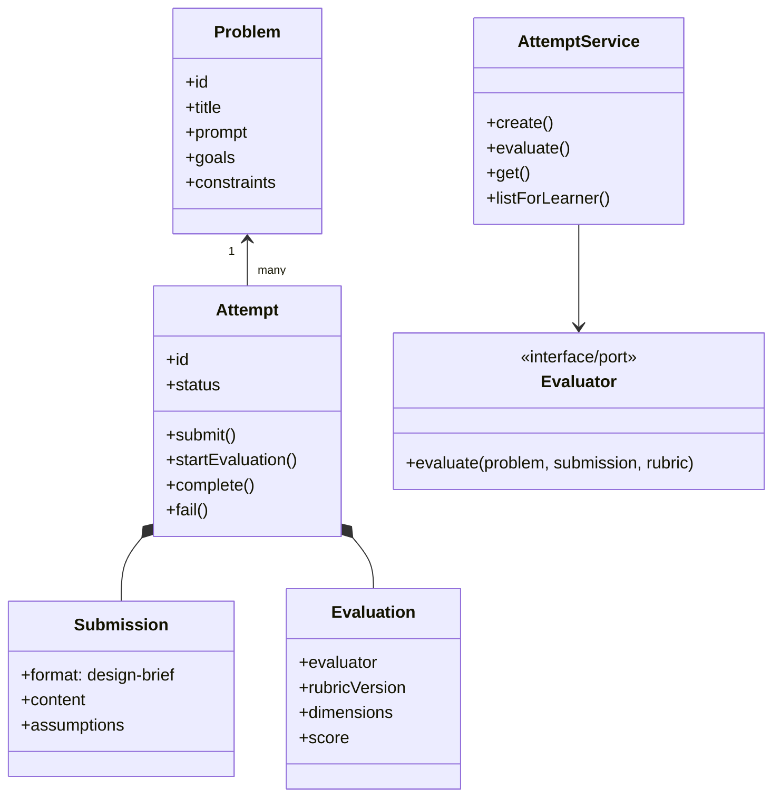

# Design note — Design Forge MVP

## MVP boundary and user flow

Design Forge supports a learner practicing one of three bounded LLD prompts. The learner selects a prompt, reads design signals and constraints, writes a **design brief**, submits it, sees evaluation status, receives criterion-level feedback, and later opens the saved attempt in their trail.

```text
Problem selected
  → design brief written
  → attempt saved as SUBMITTED
  → evaluator runs (EVALUATING)
  → COMPLETED with rubric feedback, or FAILED with the draft retained
  → learner opens history and tries another attempt
```

The text brief is intentional. It is fast to produce, preserves design reasoning, and gives an evaluator evidence without building a diagram parser or code runner. The formatted scaffold suggests—not mandates—scope, responsibilities, flows, and edges.

## Core model



| Component | Responsibility | Why it exists |
|---|---|---|
| `Problem` | Owns prompt context, goals, and constraints. | Keeps the evaluator and UI grounded in a particular challenge. |
| `Submission` | Validates the chosen format and minimum evidence. | Prevents a meaningless evaluation request. |
| `Attempt` | Owns valid lifecycle transitions and timestamps. | The most important reliability rule should not live in a controller. |
| `Evaluation` | Holds a versioned rubric result and derives overall score. | Results remain interpretable if the rubric changes. |
| `AttemptService` | Orchestrates saving, idempotency, scheduling, evaluation, and retrieval. | Keeps HTTP concerns out of domain behaviour. |
| repositories | Load/save ports, currently in-memory. | Lets persistence change independently. |
| evaluator | Produces an `Evaluation` using a fixed contract. | Makes heuristic, LLM, and human-review approaches replaceable. |

## State and failure behaviour

`Attempt` permits only:

```text
DRAFT → SUBMITTED → EVALUATING → COMPLETED
                       └────────→ FAILED ───(retry)──► SUBMITTED
          SUBMITTED ────────────→ FAILED ───(retry)──► SUBMITTED
```

The service saves the submitted attempt **before** it schedules evaluation. To eliminate race conditions under concurrent requests with the same idempotency key (e.g. 20 parallel requests), `InMemoryIdempotencyRepository` provides an `acquire(key)` mutex: the first request acquires the lock, while concurrent requests await the in-flight operation and receive a replayed response without duplicate attempt creation.

If evaluation throws, the attempt changes to `FAILED` with a practical message; the learner’s original brief remains intact. From `FAILED`, the attempt can be re-evaluated via `retryEvaluation(attemptId)` / `POST /api/attempts/:id/retry`, transitioning back to `SUBMITTED` and re-entering the evaluation queue.

## Evaluation design

### Deterministic responsibilities

- valid problem, content length, and allowed submission format (`design-brief`, `diagram`, `code`)
- state transition legality, idempotency mutex locking, and timestamps
- rubric shape, evaluator identity, and strict numeric score range validation (1–5)
- boundary-safe keyword matching (preventing false positives such as `downstream` matching `owns`)
- problem-specific domain keyword detection (e.g. `spot`/`ticket` for Parking Lot, `coin`/`item` for Vending Machine)

### Judgment-heavy responsibilities (future LLM adapter)

- whether each class has a cohesive responsibility
- whether a stated abstraction meaningfully reduces coupling
- whether a trade-off is appropriate to the prompt
- specific improvement suggestions grounded in the submission

The prototype includes three evaluator implementations behind the `Evaluator` port:
1. `HeuristicRubricEvaluator`: deterministic evidence detection grounded in problem domain terms.
2. `RuleBasedRubricEvaluator`: structural document verification checking explicit sections (Scope, Classes, Flows, Trade-offs).
3. `CompositeEvaluator`: orchestrates and combines multiple evaluators using the Composite pattern.

A production `LlmRubricEvaluator` implements the same port:

```js
async evaluate({ problem, submission, rubric }) => Evaluation
```

It provides the problem, rubric, and learner brief to the model; requests JSON shaped as `criterion → score → evidence → concern → suggestion → confidence`; validates it against the local rubric IDs and score range; and rejects or retries invalid model output. Storing `evaluator` and `rubricVersion` makes results auditable.

## Change tests

| Expected change | Impact | Implementation in Codebase |
|---|---|---|
| **Change test A:** Today the learner submits text. Later the platform supports a class diagram. | `SubmissionFormat` enum (`design-brief`, `diagram`, `code`) allows `Submission` to accept diagram or code content without changing `Attempt` lifecycle, history, or HTTP orchestration. | Implemented in `src/domain/models.js` and verified in `test/domain.test.js`. |
| **Change test B:** Today feedback comes from one evaluator. Later you add rule-based or human review. | All evaluators implement the `Evaluator` port contract. `RuleBasedRubricEvaluator` and `CompositeEvaluator` demonstrate pluggable and combined evaluators without rewriting `AttemptService`. | Implemented in `src/infrastructure/heuristic-evaluator.js` and verified in `test/attempt-service.test.js`. |
| Evaluation becomes slow | Replace the scheduler adapter with a durable queue; retain `SUBMITTED/EVALUATING` and idempotency rules. | Architecture-ready; scheduler is injected. |
| Need persistence | Replace in-memory repositories with database adapters; service and domain tests remain unchanged. | Repository interfaces cleanly separated. |

## Key trade-offs

1. **A design brief over a diagram editor:** maximises meaningful evidence per engineering hour. It loses visual relationships but avoids a weak canvas experience.
2. **Fixed rubric over a reference-solution diff:** makes alternative valid designs possible, though the feedback must be calibrated over time.
3. **Monolith over services:** appropriate for a 2-day practice product. The evaluator is a seam, not a separately deployed service.
4. **Transparent heuristic over a live LLM:** demonstrates the evaluator interface and feedback UX without hiding product behaviour behind credentials. The honest limitation is lower semantic quality.

